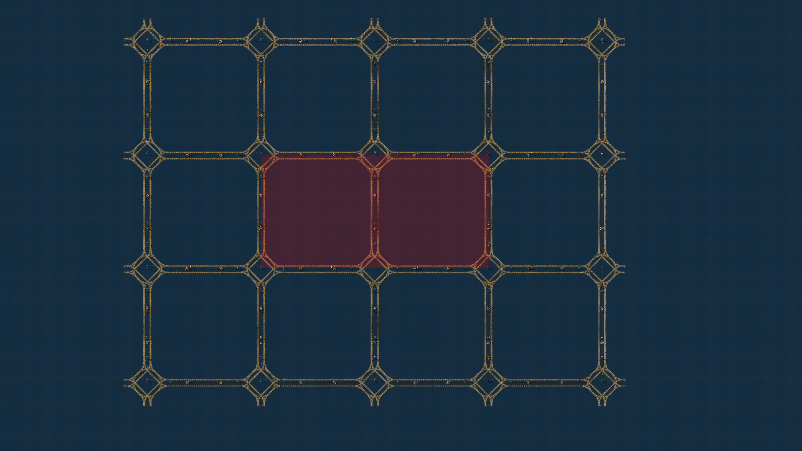
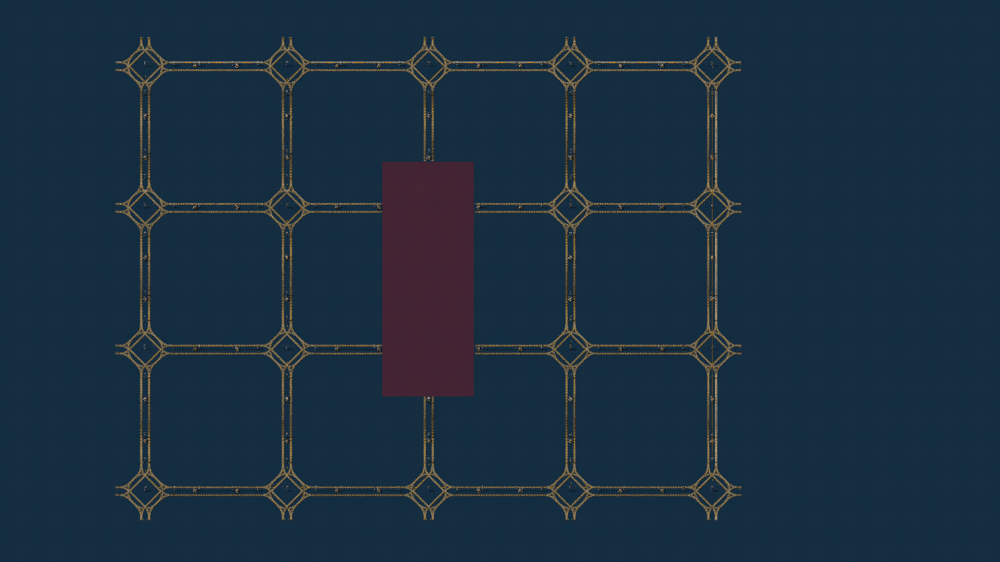
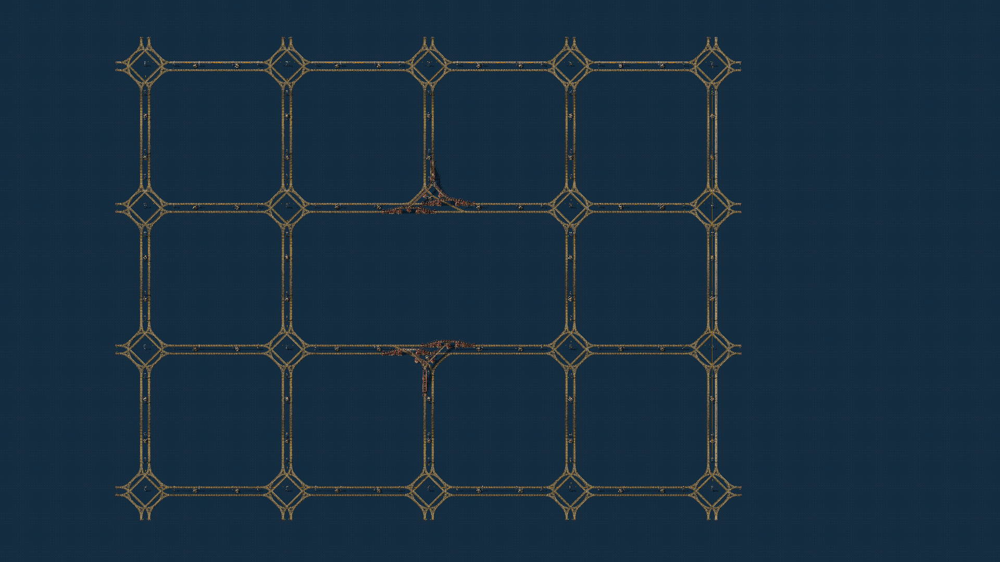
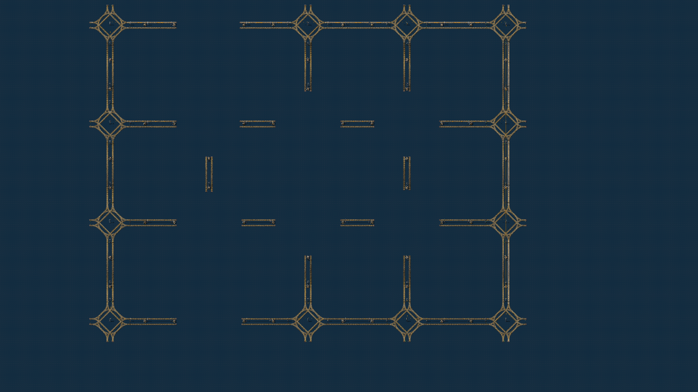
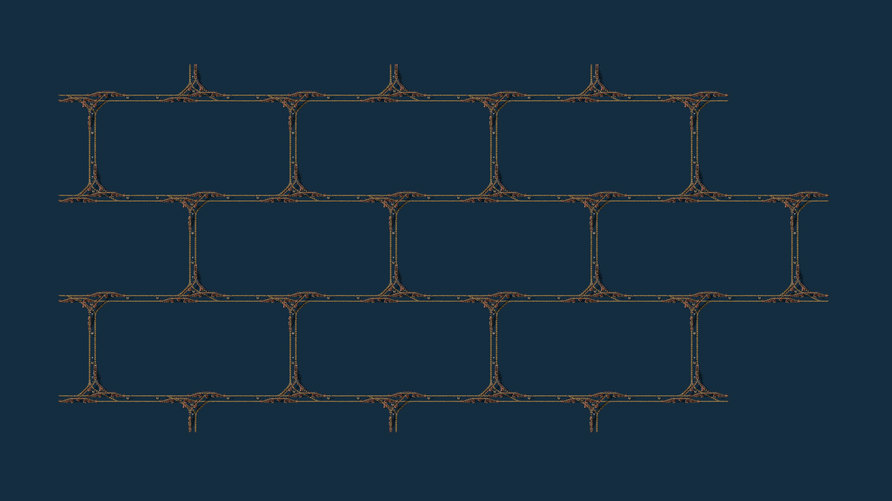

# Progressive Rails

## Purpose

Progressive Rails is a city block rails blueprint book for Factorio. It tackles a very specific problem: how do you start with a medium sized city block structure, but later upgrade to a high capacity rail network? To achieve this, it starts with a Tier 1 that uses at grade roundabout intersections, then has a Tier 2 with elevated T intersections and double sized city blocks.

## Features

### All Tiers

* Full bot construction coverage
* Optimized for 4-length trains
* Works with shorter trains
* Demand-based trains
* Left hand drive
* Grid aligned on the same grid, where possible
* Rotation friend, where possible

### Tier 1

* Roundabout intersections
* Only uses basic rail research
* Square city blocks
* 108 by 108 grid
* Side stops
* Single side blueprints available

### Tier 2

- Elevated T junction
- Rectangle city blocks
- Rail yard stops
- Up to 10 rail yard stops dropoff/pickup sized stops per block.

### Tier 3

- Legendary Roboports

## Upgrading

Let's say you have this initial Tier 1 layout, with the block that you want to upgrade highlighted.

The simplest upgrade uses the transitional full blueprint, which has roundabouts on all corners. Start by removing the middle to allow for merging two adjacent city blocks:

Then use the blueprint "T1 -> T2 CB Mixed All PB"

A more disruptive upgrade turns the roundabouts in each corner into T intersections, disconnecting some edges.

Then use "Full CB T2 PB" in the opened area:

Fully tier 2 city blocks will have a brick-like structure, with blocks at offsets:

However, it may make sense to have some low traffic areas of a base perpetually kept as tier 1.

## Status

* The basic Tier 1 and Tier 2 city blocks should be done
* Some upgrade blocks are available, but are incomplete
* Defense perimeters are available, but incomplete
* Basic loading and unloading is complete, but individual levels of inserters and quality levels of pumps are needed
* In general, more testing is needed